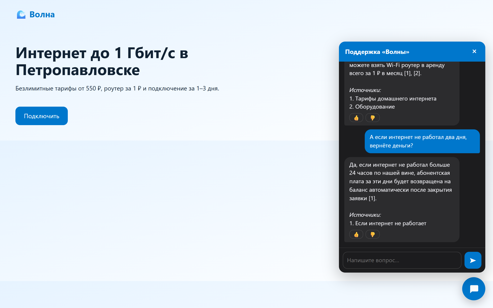
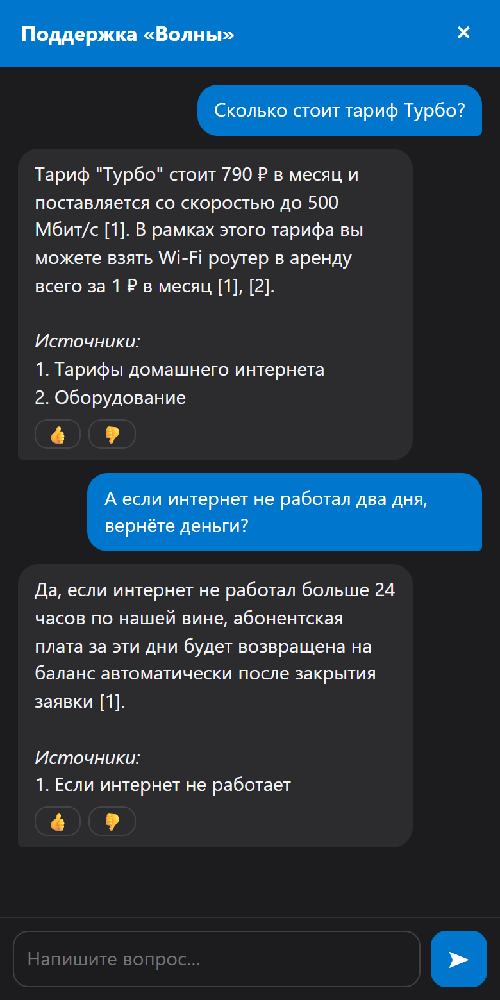

# RAG Support Bot — ИИ-поддержка по базе знаний компании

Бот в Telegram и виджет на сайте отвечают клиентам по документам компании — со ссылками на источники,
а сложные вопросы передают живым операторам. Качество ответов не «на глаз», а измерено (evals).

[](https://github.com/egorstep147/rag-support-bot/actions/workflows/ci.yml)
 


<p>
  
  
</p>

*Настоящие ответы локальной Gemma 4 E4B по базе демо-провайдера: каждый факт со ссылкой на документ.*

## Качество (evals)

Контрольные вопросы с эталонными ответами — в `companies/<компания>/evals.yaml`, отчёты — в [`evals/`](evals/).
Прогон полностью локальный, без платных API: ответы — **Gemma 4 E4B** (Ollama, ноутбучная RTX 3060),
эмбеддинги — **bge-m3**.

| База | Поиск vector hit@1 / hit@6 / MRR | fts | hybrid | Верно | Полностью верно | Без выдумок | Честный отказ |
|---|---|---|---|---|---|---|---|
| [Провайдер «Волна»](evals/provider.md) — 18 вопросов + 4 «ловушки» | 89% / 100% / 0.92 | 67% / 94% / 0.78 | 89% / 100% / 0.92 | 89% | 83% | 78% | 100% |
| [Школа «Код»](evals/school.md) — 14 вопросов + 3 «ловушки» | 100% / 100% / 1.00 | 79% / 100% / 0.85 | 100% / 100% / 1.00 | 100% | 100% | 100% | 100% |

Среднее время ответа ~22–24 с — это 4B-модель на ноутбуке; с Gemini Flash — 1–2 с. Судья здесь та же маленькая
Gemma и иногда ошибается сам (в отчёте провайдера «Оставьте заявку мастеру [1]» засчитан как неполный), поэтому
каждая ошибка разобрана в отчёте вместе с ответом бота — видно, где виноват бот, а где судья.

**Как читать.** *hit@k* — нужный документ среди k найденных; *MRR* — насколько высоко он в списке.
«Верно» и «без выдумок» оценивает модель-судья, сверяя ответ с эталоном и с найденными фрагментами.
«Честный отказ» — вопросы не по теме и попытки взломать подсказку («игнорируй инструкции…»): бот должен
сказать «не знаю» и позвать оператора.

**Что показали замеры.** Гибридный поиск (по смыслу + по словам) на базе провайдера оказался *хуже* чисто
векторного: частые слова вроде «интернет» вытесняли нужные куски (hit@6 89% против 100%). Поэтому вес поиска
по словам — настройка компании, подобранная по evals (`fts_weight`, у «Волны» = 0). На базах с артикулами
и кодами ошибок поиск по словам незаменим — там вес стоит оставить.

## Как это работает

```
документы, сайт, FAQ,         нарезка по заголовкам        вектор (bge-m3 / Gemini) ─┐
Google Docs, Notion   ──►     «Тарифы › Турбо»       ──►   + полнотекстовый индекс  ─┤ PostgreSQL
                              sha256: только изменённое                               │ pgvector
вопрос ──► переписать по диалогу ──► поиск (vector / fts / взвешенный RRF) ──► top-k ─┘
       ──► модель отвечает только по фрагментам, ссылки [1][2] ──► «не знаю» → оператор
```

- **Источники:** файлы (PDF, DOCX, MD, TXT, HTML), FAQ, сайт (sitemap или обход), Google Docs, Notion.
  Пересинхронизация пересчитывает только изменённые документы — эмбеддинги стоят денег.
- **Ответ** — только по найденным фрагментам, с перенумерованными ссылками на источники. Нет ответа —
  честное «не знаю» и кнопка «позвать оператора». Текст документов модель получает как данные, а не как команды.
- **Операторы** — в группе Telegram с темами: каждый клиент — отдельная тема с историей. Ответ оператора
  уходит клиенту (в Telegram или на сайт), кнопкой **«📚 В FAQ»** он попадает в базу — бот учится.
- **Виджет для сайта** — одна строка `<script>`, тот же ИИ и те же операторы. Лимиты запросов,
  очистка ссылок от `javascript:` (XSS), `frame-ancestors` — только для разрешённых сайтов.
- **Админка в боте:** загрузка файлов прямо в чат, `/sync`, `/faq`, `/stats` (доля закрытых ИИ вопросов,
  передачи оператору, 👍/👎) и `/gaps` — вопросы, на которые база не ответила: что дописать.
- **Любая модель:** Gemini, Claude, OpenAI-совместимые (OpenRouter, DeepSeek, локальная Ollama) — одна строка в `.env`.

```
src/support/
├── rag/        loaders · chunking · ingest (синхронизация) · retrieve (гибридный поиск) · answer
├── evals.py    метрики поиска и ответов, модель-судья, отчёт
├── chat.py     диалоги Telegram + сайт, передача оператору, темы группы
├── bot/        клиент, операторы, админка
├── api/web.py  API виджета;  web/  widget.js, окно чата, демо-сайт (/demo)
└── llm/        адаптеры моделей
companies/      provider («Волна»), school («Код»): config.yaml, knowledge/, faq.yaml, evals.yaml
```

## Быстрый старт

```sh
cp .env.example .env              # BOT_TOKEN, GEMINI_API_KEY (или локальная Ollama), POSTGRES_PASSWORD, DATABASE_URL
docker compose up -d              # PostgreSQL с pgvector
uv sync && uv run support migrate && uv run support sync
uv run support eval               # замер качества → evals/<компания>.md
uv run support                    # бот + виджет: http://127.0.0.1:8086/demo
```
Без ключей, полностью локально — блок «Ollama» в `.env.example` (`ollama pull gemma4:e4b-it-qat`, `bge-m3`).
Деплой на VPS — [deploy/DEPLOY.md](deploy/DEPLOY.md).

## Своя компания

1. `companies/mycompany/config.yaml`: название, тон, часы операторов, источники.
2. Документы — в `knowledge/` (или `site` / `gdoc` / `notion` в конфиге), частые вопросы — в `faq.yaml`.
3. 15–30 контрольных вопросов в `evals.yaml` — из реальных обращений клиентов.
4. `COMPANY=mycompany uv run support sync && uv run support eval` — смотрим цифры, подкручиваем `top_k`,
   `fts_weight`, дописываем базу по `/gaps`.

## Разработка

```sh
uv run pytest            # 17 тестов: поддельные модель и Telegram, настоящий PostgreSQL
uv run ruff check src tests && uv run ruff format src tests
```

## Лицензия
MIT
